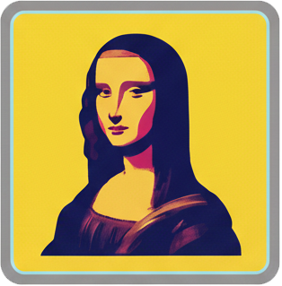
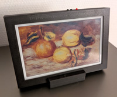
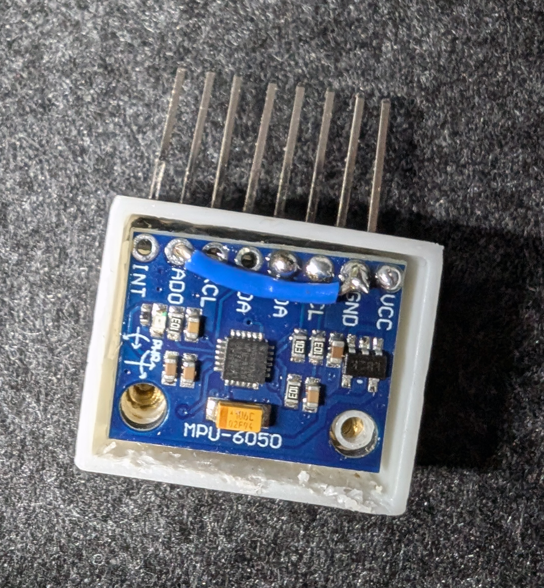
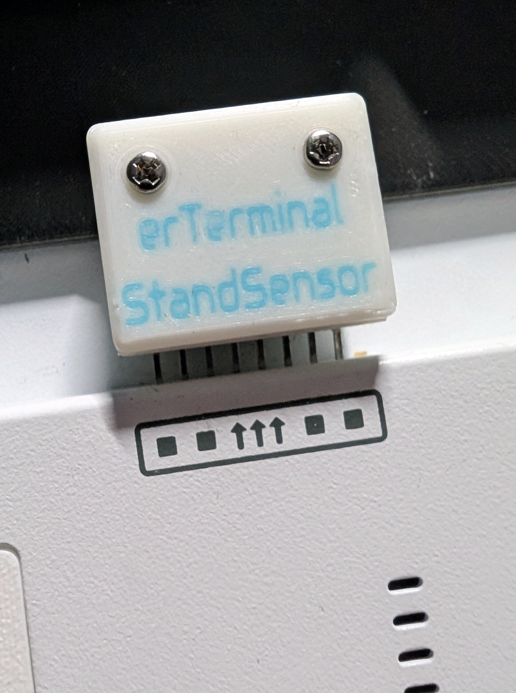
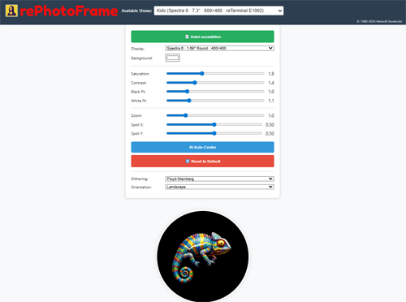

<center>
  
  <br>
  <a href="https://microgulp.dev/en/ready/">
    
  </a>
  <br>
  
</center>
<br><br>

# µPhotoFrame™ - WiFi-based E-Ink Photo Frame

**An intelligent, remote-controlled photo frame firmware for reTerminal E1001/E1002, GooDisplay NeoFrame (GDP073EW1), and Waveshare ESP32-S3 1.54inch e-Paper (G)**

**Keywords:** NeoFrame, GDP073EW1, GDEP073E01, GooDisplay, Waveshare, GDEY0154F51, BWRY, reTerminal, E1002, E1001, Spectra 6, E-Ink, e-paper, ESP32-S3, photo frame, µPhotoFrame

---

## 🌍 Languages / Sprachen

- [English](#english)
- [Deutsch](#deutsch)

---

<a name="english"></a>
## 📖 English

### ⚠️ Project Status
**Currently in active development...**

### ✨ Features

This project includes photo frame firmware for the reTerminal E1001/E1002, GooDisplay NeoFrame (GDP073EW1), and Waveshare ESP32-S3 1.54inch e-Paper (G), as well as a server application for managing and preparing photo albums with several special features:

#### 🖼️ Display Support
- ✅ **reTerminal E1001:** 7.5" Grayscale (4-Level)
- ✅ **reTerminal E1002:** 7.3" Spectra 6 (Full Color)
- ✅ **NeoFrame:** GooDisplay GDP073EW1 · Spectra 6 7.3" 800×480 (GDEP073E01, display ID `9`, same shows as E1002)
- ✅ **Waveshare 1.54G:** ESP32-S3 AIoT · 200×200 · Red/Yellow/Black/White (display ID `f`, no battery)
- ✅ **Auto-Rotation (E1002):** MPU6050 sensor support; NeoFrame and Waveshare have no accelerometer
- ✅ **Keep last image:** If the photo server is offline, the last loaded photo stays on the panel
- ✅ **Low Power:** Configurable rest periods. Deep sleep is on by default on reTerminal and Waveshare; NeoFrame stays off so USB power banks do not cut out
- ✅ **Languages:** Web UI and firmware config via i18x — English, German, Chinese (browser default, changeable)

#### 📡 WiFi Management
- ✅ Remote management via web interface
- ✅ Multiple image lists with remote switching
- ✅ Automatic time synchronization
- ✅ Easy WiFi configuration via access point

#### 🎨 Image Processing
- ✅ Fully automated image processing in browser
- ✅ AI-powered cropping (local TensorFlow.js / COCO-SSD — `npm run init` / `gulp INIT`)
- ✅ Auto-optimize: local histogram plus subject detection — night and bright high-key photos keep the person visible
- ✅ Adding photos disables Back and warns before the tab is closed
- ✅ Extreme compression with highest quality
- ✅ Support for both landscape and portrait formats
- ✅ Custom `.ink` format for optimal storage (mimetype image/ink)

#### ⏱️ Flexible Timing
- ✅ Display duration: 1 minute to 6 hours per image list
- ✅ Per-show rest period (default 22:00–06:00): the frame stays in deep sleep and keeps the last photo; same start and end hour turns rest off
- ✅ Different modes: sequential, reverse, or random

#### 💾 Storage
- ✅ SD card support for offline operation
- ✅ Store 2-5 million images on a 2TB SD card
- ✅ Import/Export functionality for image lists
- ✅ No database server required (JSON-based)

#### 🎛️ User Controls
- ✅ Hardware buttons on reTerminal for next/previous image and mode
- ✅ WiFi reconfiguration on reTerminal (hold both buttons for 1 second)
- ✅ **Boards without buttons (NeoFrame, Waveshare 1.54G):** open AP `microPhotoFrame` after a cold start → `http://192.168.4.1/`, or the config page on the home-LAN IP. With deep sleep on (Waveshare default) the AP lasts 5 minutes; NeoFrame keeps it open while deep sleep stays off
- ✅ Low battery warning display

### 🚀 First installation

Full handbook: [INSTALLATION.md](INSTALLATION.md). Server variants: [docs/](docs/).

#### 1. Install the server

```bash
git clone https://github.com/mamekudz/microPhotoFrame.git
cd microPhotoFrame
npm install
npm run init
```

`npm run init` (or `npx gulp INIT`) downloads the local COCO-SSD model into `src/libs/models/` for AI crop. Run it once after a fresh clone.

Start a server. Default on this project is **IIS on port 888**. Node Express: see [INSTALLATION.md](INSTALLATION.md). Open the web UI, e.g. `http://192.168.0.69:888/`.

#### 2. Create a channel

A channel is **User ID / Group ID / display**. Shows live under `shows/{userId}/{groupId}/{displayId}/`.

Example: User ID `mamekudz`, Group ID `family`, Spectra 6 7.3" (id `9`) → `http://192.168.0.69:888/shows/mamekudz/family/9`

In the web UI header choose **+ New Channel**, enter User ID and Group ID, pick the display, create the channel, then activate a show. The **Default** checkbox is used when the URL has no channel path. The UI always shows the real `/shows/…` URL.

The display type is fixed after create. The device panel comes from the firmware; you do not type it on the frame.

#### 3. Flash firmware

**👉 [Open Web Flasher](https://mamekudz.github.io/microPhotoFrame/firmware/flasher.html)**

1. Use a **data** USB cable (charge-only cables do not create a COM port). Windows Device Manager must show the port as connected (not *Unknown*).
2. In µGulp choose **Target** explicitly: `reTerminal E1002`, `NeoFrame` or `Waveshare 1.54G`. USB chip is only a hint — CH340 is not automatically NeoFrame.
3. `FIRMWARE_UPLOAD` picks a live USB serial port. Typical IDs: native ESP32-S3 CDC `303A:1001` (XIAO / often E1002 or Waveshare), CH340 `1A86:7523` (UART adapter).
4. Wait until complete (~2 minutes)

More options: [Firmware README](firmware/README.md)

#### 4. Configure the device

After first boot (or the open AP on buttonless boards — 5 minutes when deep sleep is on):

1. Connect the phone to WiFi **"microPhotoFrame"** (open, 2.4 GHz), then open `http://192.168.4.1`
2. Enter home WiFi credentials
3. Enter only the **server URL** (`http://192.168.0.69:888`) and the **User ID**
4. Load **Group IDs** — the server lists groups that match that User ID and this device’s display
5. Pick a Group ID, save, restart

A frame whose panel does not match the channel shows that the URL is not intended.

### 🛠️ Hardware Expansion

**MPU6050 Acceleration Sensor (Optional)**

Add automatic orientation detection with 3D-printed case:
- 📐 [Build Instructions & 3D Files](https://makerworld.com/en/models/2099919-reterminal-e1002-frame-and-stand#profileId-2270833)
- 🎯 Automatic landscape/portrait detection
- 🔄 Instant image switching on rotation

<br>
<center>
  
</center>
<br>

### 📚 Documentation

- **[Installation handbook](INSTALLATION.md)** - First install, channels (User ID / Group ID), server variants
- **[Firmware README](firmware/README.md)** - Detailed firmware documentation
- **[ink-encoder Package](ink-encoder/README.md)** - NPM package documentation
- **[Technical Overview](docs/technical_overview.md)** - Architecture and design
- **[.ink orientation on PC](docs/INK_ORIENTATION_PC.md)** - Portrait encode vs. Windows preview (no mirror)
- **[Server Setup](docs/)** - IIS, Apache, NGINX, Node.js guides

### 🛠️ Development Gulp tasks (µGulp™)

<p align="center">
  <a href="https://microgulp.dev/en/ready/">
    
  </a>
</p>

The badge applies to **this repository’s development/build Gulp tasks**, not to the device firmware.

These tasks are **repository development/build helpers**. They do not flash or certify the device firmware.

The gulpfile is prepared for [µGulp™](https://microgulp.dev/en/): `µParameters` forms (`BUILD_SERVER_PACKAGES`, `ENCODE_INK`, `BACKUP_TO_NAS`), task-reported progress (`CreateProgress` / `ReportProgress`), a `LogTable` artifact listing after server packages, and `µWatch` on firmware sources, favicon PNGs and branding copies. Display names and groups are i18n’d via `i18x/gulp/`. This is maintainer self-certification against the published [µGulp™ Ready](https://microgulp.dev/en/ready/) requirements, not an independent audit.

**Prerequisites:** Node.js 22+, `npm install` in the repo root (workspace package `ink-encoder/` 2.1.0 is linked automatically), then `npm run init` once to download the local COCO-SSD model into `src/libs/models/`. Windows for `BACKUP_TO_NAS` (robocopy) and NSIS installer builds. PlatformIO (`pio`) for firmware tasks. `gulp-mu-gulp-api` is a devDependency. A neighbor checkout of `../ink-encoder` is **not** required. Config fallback `./config/ink-encode-config.json` is not in the repo — use `config/ink-encode-config.example.json` or a local copy.

**CLI (plain Gulp does not apply `µParameters` defaults).** Set `MICROGULP_PARAM_<ID>` or `MICROGULP_PARAMS` JSON, or use the task-coded fallbacks below:

| Command | Inputs / defaults | Result |
| :--- | :--- | :--- |
| `npx gulp --tasks` | — | Lists exported task names |
| `npx gulp INIT` / `npm run init` | optional `MICROGULP_PARAM_FORCE=true` or `FORCE_AI_MODEL=1` | Downloads the COCO-SSD auto-center model into `src/libs/models/` |
| `npx gulp COPY_RAWMEDIA_WEBASSETS` | none | Copies `rawmedia/Logo.png` and `LogoText.png` to `webassets/` when present |
| `npx gulp BUILD_SERVER_PACKAGES` | `MICROGULP_PARAM_SERVERTYPE=node\|iis\|apache\|nginx\|all`. Without it the CLI may prompt (`RequestSelectInput`, default `all` on that prompt). The `µParameters` default is **not** applied automatically. | Zip(s) in `dist/` |
| `npx gulp BUILD_ALL_SERVER_PACKAGES` | none | All four zips in `dist/` |
| `npx gulp ENCODE_INK` | **required** `MICROGULP_PARAM_INPUT` or `input`; optional `MICROGULP_PARAM_OUTPUT` / `MICROGULP_PARAM_CONFIG` (code fallback `./config/ink-encode-config.json`, not shipped; example: `./config/ink-encode-config.example.json`) | `.ink` files |
| `npx gulp PUBLISH_INK_ENCODER` | CLI **dry-run by default**. Real upload: `MICROGULP_PARAM_DRYRUN=false` and `MICROGULP_PARAM_CONFIRM=true`. Optional `MICROGULP_PARAM_OTP`, `MICROGULP_PARAM_SKIPTESTS=true` | `npm publish` of the workspace package only (not PhotoFrame) |
| `npx gulp BACKUP_TO_NAS` | Destination: `MICROGULP_PARAM_DESTINATION` or `MICROPHOTOFRAME_NAS_BACKUP`, else the **code** fallback `Z:\Projects\microPhotoFrame` (that folder must already exist) | robocopy `/MIR` mirror |

**NAS backup is a mirror with deletions, not a versioned backup.** Extra files on the destination are removed. Regenerable trees (`node_modules`, `dist`, `tmp`, `.pio`, …) are not copied; leftovers with those names are deleted **inside the destination only**. `lib` / `build` are excluded only as project-root (and `firmware/lib`) paths so vendored `src/libs` is kept. Drive/share roots and destinations that are the project folder, a parent, or a child of it are refused. Junctions/symlinks that point outside the destination are not followed for deletion.

`npx gulp FIRMWARE_BUILD` / `FIRMWARE_UPLOAD` / `FIRMWARE_MONITOR` wrap PlatformIO for the µGulp **Target** (`reTerminal E1002`, `NeoFrame` or `Waveshare 1.54G`). Gulp locates `pio` under `%USERPROFILE%\.platformio\penv` when it is missing from PATH, logs pio output in the dashboard, and for upload requires a live USB serial port (`--upload-port`). `FIRMWARE_RESTORE_FACTORY` writes a stock image at `0x0` when one is present under `firmware/factory/<target>/`. `µWatch` is dashboard-only; on the CLI run the task again after edits.

**Checked on 2026-09-18** (this workstation: Windows 10.0.22631, Cursor, Node v22.19.0, gulp 5.0.1, gulp-mu-gulp-api 0.4.2, µGulp™ 0.9.5): HTTP dashboard (`microgulp-serve --http`) `ENCODE_INK` parameter form, successful synthetic PNG→`.ink` (`DONE 100%`, visible log), and a missing-file failure (`No files found`). CLI the same day: `MICROGULP_PARAM_INPUT`/`OUTPUT`/`CONFIG` success and missing-input abort. `node --test tools/nas-backup.test.mjs`. **Not claimed as tested here:** µWatch arming, `LogTable` after server packages, firmware flash, live NAS backup, `npm publish`.

### 🎁 Included Content

The project includes a sample image list with classic paintings (~100 images, 1 MB).

### 📄 License

MIT License - see [LICENSE](LICENSE) for details

---

<a name="deutsch"></a>
## 📖 Deutsch

# µPhotoFrame™ - WiFi-basierter E-Ink-Fotorahmen

**Intelligente, ferngesteuerte Bilderrahmen-Firmware für reTerminal E1001/E1002, GooDisplay NeoFrame (GDP073EW1) und Waveshare ESP32-S3 1.54inch e-Paper (G)**

**Suchbegriffe:** NeoFrame, GDP073EW1, GDEP073E01, GooDisplay, Waveshare, GDEY0154F51, BWRY, reTerminal, E1002, E1001, Spectra 6, E-Ink, E-Paper, ESP32-S3, Fotorahmen, µPhotoFrame

---

### ⚠️ Projektstatus
**Aktuell noch in aktiver Entwicklung...**

### ✨ Funktionen

Dieses Projekt enthält eine Fotorahmen-Firmware für das reTerminal E1001/E1002, GooDisplay NeoFrame (GDP073EW1) und Waveshare ESP32-S3 1.54inch e-Paper (G), sowie eine Server-Applikation für die Verwaltung und Aufbereitung von Fotoalben mit einigen Besonderheiten:

#### 🖼️ Display-Unterstützung
- ✅ **reTerminal E1001:** 7,5" Graustufen (4-Level)
- ✅ **reTerminal E1002:** 7,3" Spectra 6 (Vollfarbe)
- ✅ **NeoFrame:** GooDisplay GDP073EW1 · Spectra 6 7,3" 800×480 (GDEP073E01, Display-ID `9`, dieselben Shows wie E1002)
- ✅ **Waveshare 1.54G:** ESP32-S3 AIoT · 200×200 · Rot/Gelb/Schwarz/Weiß (Display-ID `f`, ohne Akku)
- ✅ **Auto-Rotation (E1002):** MPU6050; NeoFrame und Waveshare haben keinen Beschleunigungssensor
- ✅ **Letztes Bild behalten:** Ist der Foto-Server aus, bleibt das zuletzt geladene Foto auf dem Panel
- ✅ **Stromsparend:** Konfigurierbare Ruhezeiten. Deep Sleep ist an reTerminal und Waveshare standardmäßig an; am NeoFrame aus, damit USB-Powerbanks nicht abschalten
- ✅ **Sprachen:** Web-UI und Firmware-Config über i18x — Englisch, Deutsch, Chinesisch (Browser-Default, umschaltbar)

#### 📡 WiFi-Verwaltung
- ✅ Fernverwaltung über Weboberfläche
- ✅ Mehrere Bildlisten mit Fernumschaltung
- ✅ Automatische Zeitsynchronisation
- ✅ Einfache WiFi-Konfiguration über Access Point

#### 🎨 Bildverarbeitung
- ✅ Vollautomatische Bildaufbereitung im Browser
- ✅ KI-gestützter Zuschnitt (lokales TensorFlow.js / COCO-SSD — `npm run init` / `gulp INIT`)
- ✅ Auto-optimize: lokales Histogramm plus Motiverkennung — Nacht- und helle High-Key-Fotos behalten die Person
- ✅ Während Fotos hinzugefügt werden ist Zurück gesperrt; das Schließen des Tabs warnt
- ✅ Extreme Kompression bei höchster Qualität
- ✅ Unterstützung für Quer- und Hochformat
- ✅ Eigenes `.ink` Format für optimale Speicherung (mimetype image/ink)

#### ⏱️ Flexible Zeitsteuerung
- ✅ Anzeigedauer: 1 Minute bis 6 Stunden pro Bildliste
- ✅ Ruhezeit pro Show (Standard 22:00–06:00): das Gerät bleibt im Tiefschlaf und behält das letzte Foto; gleiche Start- und Endstunde schaltet die Ruhezeit aus
- ✅ Verschiedene Modi: fortlaufend, rücklaufend oder zufällig

#### 💾 Speicherung
- ✅ SD-Karten-Support für Offline-Betrieb
- ✅ 2-5 Millionen Bilder auf 2TB SD-Karte speicherbar
- ✅ Import/Export-Funktion für Bildlisten
- ✅ Kein Datenbank-Server erforderlich (JSON-basiert)

#### 🎛️ Bedienelemente
- ✅ Hardware-Tasten am reTerminal für nächstes/vorheriges Bild und Modus
- ✅ WiFi-Neukonfiguration am reTerminal (beide Tasten 1 Sekunde halten)
- ✅ **Boards ohne Taster (NeoFrame, Waveshare 1.54G):** offenes WLAN `microPhotoFrame` nach Kaltstart → `http://192.168.4.1/`, sonst die Config-Seite unter der Heimnetz-IP. Mit Deep Sleep (Waveshare-Standard) bleibt der AP 5 Minuten; am NeoFrame bleibt er offen, solange Deep Sleep aus ist
- ✅ Akkustand-Warnung bei niedrigem Ladestand

### 🚀 Erstinstallation

Ausführlich: [INSTALLATION.md](INSTALLATION.md). Servervarianten: [docs/](docs/).

#### 1. Server installieren

```bash
git clone https://github.com/mamekudz/microPhotoFrame.git
cd microPhotoFrame
npm install
npm run init
```

`npm run init` (oder `npx gulp INIT`) lädt einmal das lokale COCO-SSD-Modell nach `src/libs/models/` für den KI-Zuschnitt.

Server starten. Standard hier ist **IIS auf Port 888**. Node Express: siehe [INSTALLATION.md](INSTALLATION.md). Web-UI öffnen, z. B. `http://192.168.0.69:888/`.

#### 2. Kanal anlegen

Ein Kanal ist **User ID / Group ID / Display**. Shows liegen unter `shows/{userId}/{groupId}/{displayId}/`.

Beispiel: User ID `mamekudz`, Group ID `family`, Spectra 6 7,3" (ID `9`) → `http://192.168.0.69:888/shows/mamekudz/family/9`

Im Header **+ New Channel**: User ID und Group ID eingeben, Display wählen, Kanal anlegen, Show aktivieren. **Default** gilt, wenn die URL keinen Kanalpfad hat. Angezeigt wird immer die echte `/shows/…`-URL.

Der Displaytyp ist nach dem Anlegen fest. Das Panel kommt aus der Firmware; am Rahmen wird es nicht eingetippt.

#### 3. Firmware flashen

**👉 [Web-Flasher öffnen](https://mamekudz.github.io/microPhotoFrame/firmware/flasher.html)**

1. **Datenkabel** verwenden (Nur-Lade-Kabel erzeugen keinen COM-Port). In der Windows-Geräteverwaltung muss der Anschluss verbunden sein, nicht *Unknown*.
2. In µGulp das **Target** bewusst wählen: `reTerminal E1002`, `NeoFrame` oder `Waveshare 1.54G`. Der USB-Chip ist nur ein Hinweis — CH340 ist nicht automatisch NeoFrame.
3. `FIRMWARE_UPLOAD` nimmt einen aktiven USB-Serial-Port. Typisch: natives ESP32-S3-CDC `303A:1001` (XIAO / oft E1002 oder Waveshare), CH340 `1A86:7523` (UART-Adapter).
4. Warten bis fertig (~2 Minuten)

Weitere Optionen: [Firmware README](firmware/README.md)

#### 4. Gerät konfigurieren

Nach dem ersten Start (oder dem offenen AP ohne Taster — 5 Minuten, wenn Deep Sleep an ist):

1. Handy mit WLAN **"microPhotoFrame"** verbinden (offen, 2,4 GHz), dann `http://192.168.4.1`
2. Heim-WLAN eingeben
3. Nur die **Server-URL** (`http://192.168.0.69:888`) und die **User ID** eintragen
4. **Group IDs laden** — der Server listet Groups, die zu User ID und Display des Geräts passen
5. Group ID wählen, speichern, neu starten

Passt das Panel nicht zum Kanal, zeigt der Rahmen, dass die URL nicht vorgesehen ist.

### 🛠️ Hardware-Erweiterung

**MPU6050 Beschleunigungssensor (Optional)**

Fügen Sie automatische Orientierungserkennung mit 3D-gedrucktem Gehäuse hinzu:
- 📐 [Bauanleitung & 3D-Dateien](https://makerworld.com/de/models/2099919-reterminal-e1002-frame-and-stand#profileId-2270833)
- 🎯 Automatische Quer-/Hochformat-Erkennung
- 🔄 Sofortiger Bildwechsel bei Drehung

<br>
<center>
  
  <br><br>
  
</center>
<br>

<center>
  
</center>
<br>

### 📚 Dokumentation

- **[Installationshandbuch](INSTALLATION.md)** - Erstinstallation, Kanäle (User ID / Group ID), Servervarianten
- **[Firmware README](firmware/README.md)** - Detaillierte Firmware-Dokumentation
- **[ink-encoder Paket](ink-encoder/README.md)** - NPM-Paket Dokumentation
- **[Technische Übersicht](docs/technical_overview.md)** - Architektur und Design
- **[.ink Orientierung am PC](docs/INK_ORIENTATION_PC.md)** - Hochkant in Firmware vs. Vorschau (ohne Spiegelung)
- **[Server-Setup](docs/)** - IIS, Apache, NGINX, Node.js Anleitungen

### 🛠️ Entwicklungs-Gulp-Tasks (µGulp™)

<p align="center">
  <a href="https://microgulp.dev/en/ready/">
    
  </a>
</p>

Das Badge gilt für die **Entwicklungs-/Build-Gulp-Tasks dieses Repositories**, nicht für die Gerätefirmware.

Diese Tasks sind **Entwicklungs-/Build-Helfer dieses Repositories**. Sie flashen die Gerätefirmware nicht und sind keine Gerätezertifizierung.

Das Gulpfile ist für [µGulp™](https://microgulp.dev/de/ready/) vorbereitet: `µParameters`-Formulare (`BUILD_SERVER_PACKAGES`, `ENCODE_INK`, `BACKUP_TO_NAS`), gemeldeter Fortschritt (`CreateProgress` / `ReportProgress`), `LogTable` nach Serverpaketen sowie `µWatch` für Firmware-Quellen, Favicon-PNGs und Branding-Kopien. Anzeigenamen liegen unter `i18x/gulp/`. Das ist Maintainer-Selbstdeklaration gemäß den veröffentlichten [µGulp™-Ready-Anforderungen](https://microgulp.dev/en/ready/), keine unabhängige Prüfung.

**Voraussetzungen:** Node.js 22+, `npm install` im Projektroot (Workspace-Paket `ink-encoder/` 2.1.0 wird automatisch verknüpft), danach einmal `npm run init` für das lokale COCO-SSD-Modell unter `src/libs/models/`. Windows für `BACKUP_TO_NAS` (robocopy) und NSIS-Installer. PlatformIO (`pio`) für Firmware-Tasks. `gulp-mu-gulp-api` ist eine devDependency. Ein Nachbar-Checkout von `../ink-encoder` ist **nicht** nötig. Der Config-Fallback `./config/ink-encode-config.json` liegt nicht im Repo — `config/ink-encode-config.example.json` oder eine lokale Kopie verwenden.

**CLI (gewöhnliches Gulp übernimmt `µParameters`-Defaults nicht automatisch).** `MICROGULP_PARAM_<ID>` bzw. `MICROGULP_PARAMS` setzen oder die im Task-Code hinterlegten Fallbacks nutzen:

| Aufruf | Eingaben / Defaults | Ergebnis |
| :--- | :--- | :--- |
| `npx gulp --tasks` | — | Exportierte Tasknamen |
| `npx gulp INIT` / `npm run init` | optional `MICROGULP_PARAM_FORCE=true` oder `FORCE_AI_MODEL=1` | Lädt das COCO-SSD-Auto-Center-Modell nach `src/libs/models/` |
| `npx gulp COPY_RAWMEDIA_WEBASSETS` | keine | Kopiert `rawmedia/Logo.png` und `LogoText.png` nach `webassets/`, sofern vorhanden |
| `npx gulp BUILD_SERVER_PACKAGES` | `MICROGULP_PARAM_SERVERTYPE=node\|iis\|apache\|nginx\|all`. Ohne Wert kann die CLI nachfragen (`RequestSelectInput`, Prompt-Default `all`). Der `µParameters`-Default greift **nicht** von allein. | Zip(s) in `dist/` |
| `npx gulp BUILD_ALL_SERVER_PACKAGES` | keine | Alle vier Zips in `dist/` |
| `npx gulp ENCODE_INK` | **pflicht** `MICROGULP_PARAM_INPUT` oder `input`; optional Output/Config (Code-Fallback `./config/ink-encode-config.json`, nicht im Repo; Beispiel: `./config/ink-encode-config.example.json`) | `.ink`-Dateien |
| `npx gulp PUBLISH_INK_ENCODER` | CLI-**Standard ist Probelauf**. Echter Upload: `MICROGULP_PARAM_DRYRUN=false` und `MICROGULP_PARAM_CONFIRM=true`. Optional `MICROGULP_PARAM_OTP`, `MICROGULP_PARAM_SKIPTESTS=true` | `npm publish` nur des Workspace-Pakets (nicht PhotoFrame) |
| `npx gulp BACKUP_TO_NAS` | Ziel: `MICROGULP_PARAM_DESTINATION` oder `MICROPHOTOFRAME_NAS_BACKUP`, sonst der **Code**-Fallback `Z:\Projects\microPhotoFrame` (Ordner muss existieren) | robocopy-`/MIR`-Spiegel |

**Die NAS-Sicherung ist eine Spiegelung mit Löschungen, kein versioniertes Backup.** Überzählige Dateien am Ziel werden entfernt. Reproduzierbare Bäume (`node_modules`, `dist`, `tmp`, `.pio`, …) werden nicht kopiert; Reste dieser Namen nur **innerhalb des Ziels** gelöscht. `lib` / `build` gelten nur als Projektroot (plus `firmware/lib`), damit `src/libs` erhalten bleibt. Laufwerks-/Freigabewurzeln sowie Ziele, die dem Projekt, einem Vorfahren oder einem Unterordner entsprechen, werden verweigert. Junctions/Symlinks nach außerhalb des Ziels werden beim Löschen nicht gefolgt.

`npx gulp FIRMWARE_BUILD` / `FIRMWARE_UPLOAD` / `FIRMWARE_MONITOR` rufen PlatformIO für das µGulp-**Target** (`reTerminal E1002`, `NeoFrame` oder `Waveshare 1.54G`) auf. Gulp findet `pio` unter `%USERPROFILE%\.platformio\penv`, wenn PATH ihn nicht kennt, schreibt die pio-Ausgabe ins Dashboard und verlangt beim Upload einen lebendigen USB-Serial-Port (`--upload-port`). `FIRMWARE_RESTORE_FACTORY` schreibt ein Stock-Image nach `0x0`, wenn eines unter `firmware/factory/<ziel>/` liegt. `µWatch` gilt nur im Dashboard; auf der CLI den Task nach Änderungen erneut starten.

**Geprüft am 2026-09-18** (dieser Rechner: Windows 10.0.22631, Cursor, Node v22.19.0, gulp 5.0.1, gulp-mu-gulp-api 0.4.2, µGulp™ 0.9.5): HTTP-Dashboard (`microgulp-serve --http`) `ENCODE_INK` mit Parameterformular, erfolgreichem synthetischem PNG→`.ink` (`DONE 100%`, sichtbares Log) und Fehlerfall fehlende Datei (`No files found`). CLI am selben Tag: Erfolg mit `MICROGULP_PARAM_INPUT`/`OUTPUT`/`CONFIG` und Abbruch ohne Input. NAS-Unit-Tests. **Hier nicht geprüft:** µWatch-Scharfschaltung, `LogTable` nach Serverpaketen, Firmware-Flash, echtes NAS-Backup, `npm publish`.

### 🎁 Enthaltener Inhalt

Das Projekt enthält eine Beispiel-Bildliste mit klassischen Gemälden (~100 Bilder, 1 MB).

### 📄 Lizenz

MIT License - siehe [LICENSE](LICENSE) für Details

---

## 🔗 Links

- **Repository:** https://github.com/mamekudz/microPhotoFrame
- **Issues:** https://github.com/mamekudz/microPhotoFrame/issues
- **Releases:** https://github.com/mamekudz/microPhotoFrame/releases
- **Web-Flasher:** https://mamekudz.github.io/microPhotoFrame/firmware/flasher.html
- **3D Files:** https://makerworld.com/de/models/2099919-reterminal-e1002-frame-and-stand#profileId-2270833

---

Made with ❤️ by Meinolf Amekudzi
